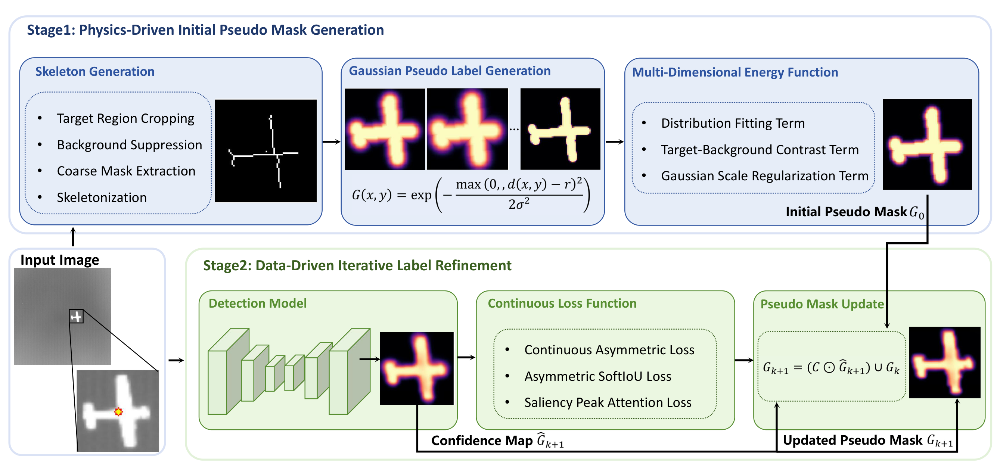
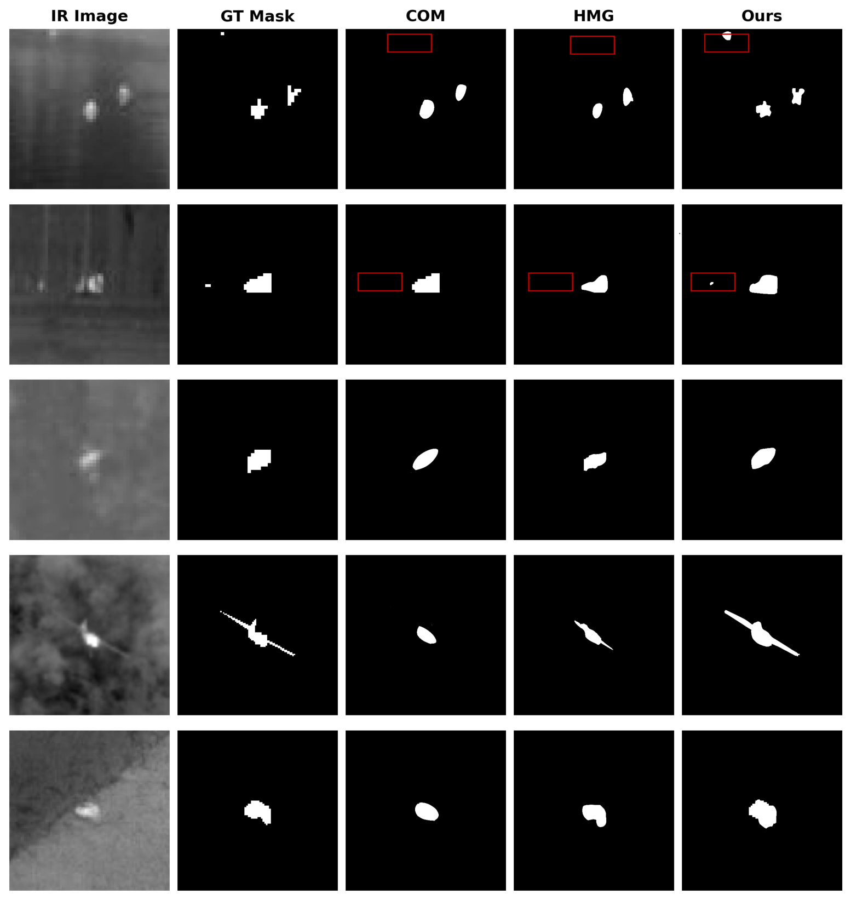
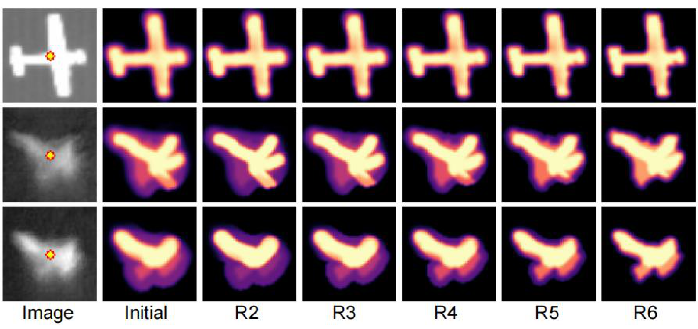
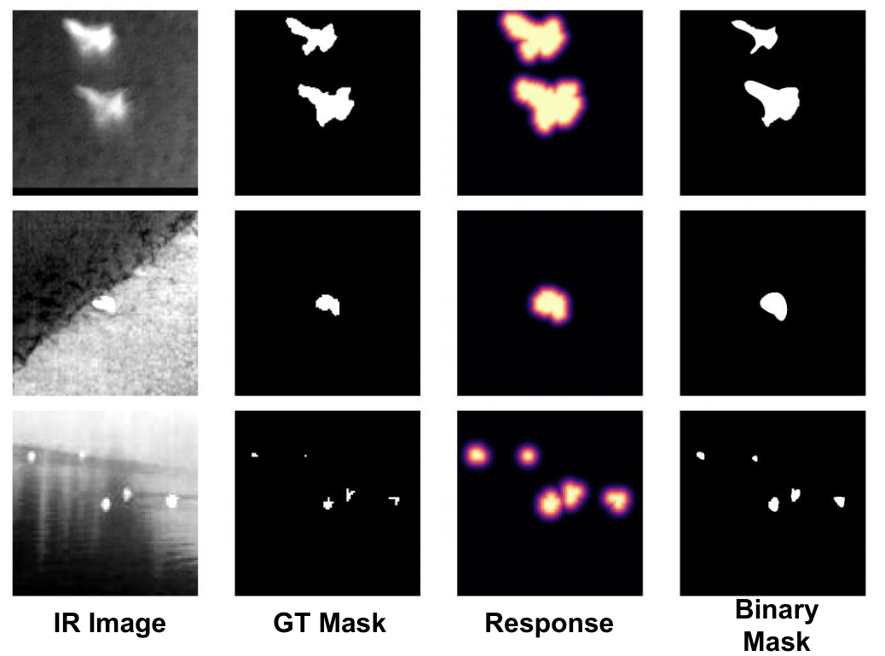

# GRSR

Official implementation of **GRSR: A Gaussian-Response and Self-Refinement Framework for Point-Supervised Infrared Small Target Detection**.

GRSR trains an infrared small target detector from single-point annotations in two stages:

1. **Physics-inspired initial pseudo masks.** Each annotated point is expanded into a continuous pseudo probability map through top-hat background suppression, skeleton extraction, a skeleton-distance Gaussian response, and energy-based selection of the response scale.
2. **Data-driven iterative label refinement.** A downstream detector (DNANet or ACMNet) is trained on the continuous pseudo masks with a continuous asymmetric loss, an asymmetric SoftIoU and a saliency peak-attention term. After each round, high-confidence predictions update the pseudo masks used in the next round.

<p align="center">
  
</p>

## Repository structure

```text
GRSR/
├── generate_pseudo_labels.py     # Stage 1 entry: points -> initial pseudo masks
├── train.py                      # Stage 2 entry: self-refinement training + evaluation
├── evaluate.py                   # Evaluate a saved checkpoint
├── grsr/
│   ├── common.py                 # dataset layout / split checks
│   ├── pseudo_labels/
│   │   └── generator.py          # skeleton, Gaussian response, energy terms
│   ├── training/
│   │   ├── trainer.py            # continuous losses, confidence-gated pseudo-mask update
│   │   ├── metrics.py            # IoU, Pd, Fa
│   │   └── evaluate.py
│   └── networks/                 # DNANet, ACMNet
├── scripts/                      # one-command runs
├── assets/                       # figures used in this README
└── third_party/NOTICE.md         # licences of adapted code
```

## Installation

```bash
git clone https://github.com/SHANOAL/GRSR.git
cd GRSR
conda create -n grsr python=3.10 -y
conda activate grsr
pip install -r requirements.txt
```

The reported experiments were run with Python 3.10, PyTorch 2.5.1 (CUDA 12.1) on a single NVIDIA H100.

## Datasets

We use SIRST-v1 (NUAA-SIRST), NUDT-SIRST and IRSTD-1K with the train/test splits of [BasicIRSTD](https://github.com/XinyiYing/BasicIRSTD). Place each dataset under `data/`:

```text
data/
├── SIRST-v1/
│   ├── images/*.png
│   ├── masks/*.png
│   └── img_idx/train_NUAA-SIRST.txt, test_NUAA-SIRST.txt
├── NUDT-SIRST/
└── IRSTD-1K/
```

Both the BasicIRSTD layout (`img_idx/train_*.txt`, `img_idx/test_*.txt`) and a flat layout (`trainval.txt`, `test.txt` in the dataset root) are accepted. The IRSTD-1K folder names `IRSTD1k_Img/` and `IRSTD1k_Label/` also work.

**Point annotations.** If `point_annotations.json` exists in the dataset root, it is used directly. Otherwise one click per target is simulated at the centroid of every connected component of the dense mask and written to `point_annotations.json`. Training only sees the pseudo masks generated from these points; the dense masks of the test split are used for evaluation only.

## Quick start

Run both stages on all three datasets with DNANet and ACMNet:

```bash
bash scripts/reproduce_all.sh data 0      # <data dir> <gpu id>
```

Or run the steps one by one, as described below.

### Stage 1: initial pseudo masks

```bash
python generate_pseudo_labels.py --data-root data/SIRST-v1
```

The continuous pseudo masks are written to `data/SIRST-v1/supervision_maps_grsr/initial/*.png`. Defaults follow the paper: coarse threshold 0.5, 4 radius candidates, 25 σ candidates, λc = 1, λr = 0.5. Run `python generate_pseudo_labels.py --help` to see all options.

### Stage 2: self-refinement training

```bash
python train.py \
    --data-root data/SIRST-v1 \
    --network dnanet \
    --gpus 0 --seed 123 \
    --save-tag grsr_dnanet_SIRST-v1
```

Default settings: Adam, initial learning rate 1e-3 with cosine annealing, batch size 4, 500 epochs per round, 3 refinement rounds, γ_high = 0.9, γ_low = 0.2, λa = 1, λs = 0.5. Use `--network acmnet` for ACMNet, and `--sup-dir` to train from pseudo masks stored elsewhere.

Outputs in `results/<save-tag>/`:

```text
iteration_1.pth ... iteration_3.pth   # model after each round
final_model.pth
final_eval.txt                         # IoU / Pd / Fa per round and per threshold
pseudo_masks/iteration_2, iteration_3  # refined pseudo masks
run_config.json                        # arguments, seed and environment
```

### Evaluation

```bash
python evaluate.py \
    --model results/grsr_dnanet_SIRST-v1/final_model.pth \
    --data-root data/SIRST-v1 \
    --network dnanet --gpus 0
```

It reports IoU, and Pd and Fa over score thresholds, computed on `sigmoid(logits)`. Pd uses the 3-pixel centroid-matching rule; Fa is the ratio of falsely predicted pixels to all pixels.

## Visualizations

**Pseudo masks of GRSR and other point-supervised methods**

<p align="center"></p>

**Pseudo masks across self-refinement rounds**

<p align="center"></p>

**Continuous soft pseudo masks versus binary masks**

<p align="center"></p>

## Acknowledgements

The DNANet and ACMNet implementations, and the IoU / Pd / Fa metrics, are adapted from [DNANet](https://github.com/YeRen123455/Infrared-Small-Target-Detection). Dataset splits follow [BasicIRSTD](https://github.com/XinyiYing/BasicIRSTD). See `third_party/NOTICE.md` for licence details.
